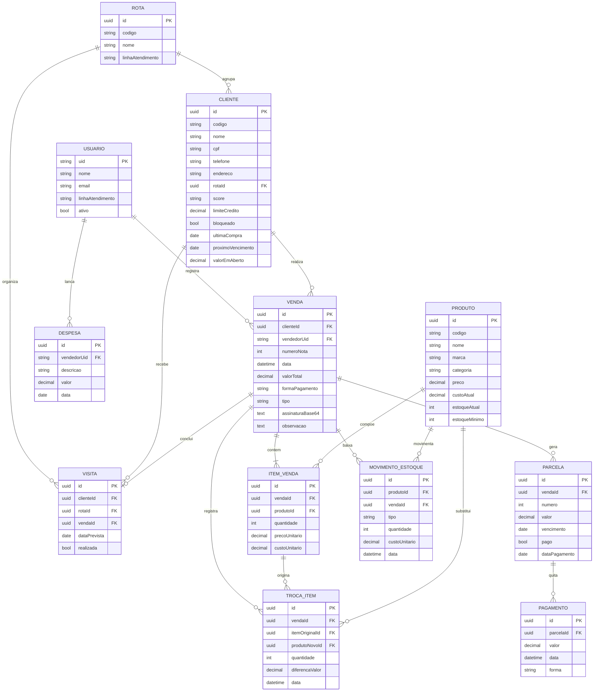
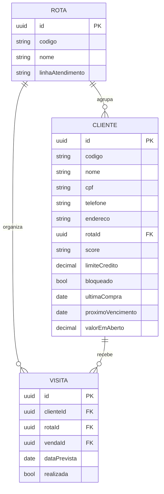
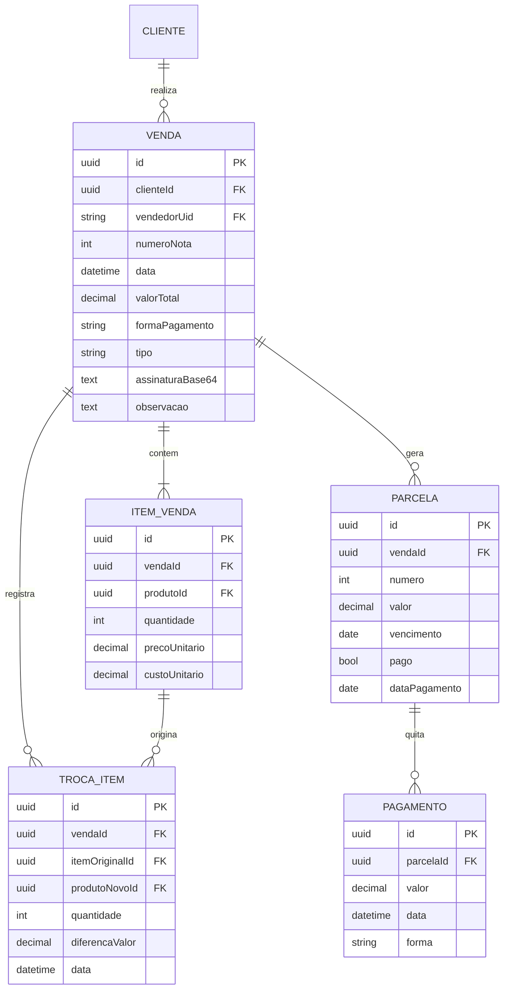
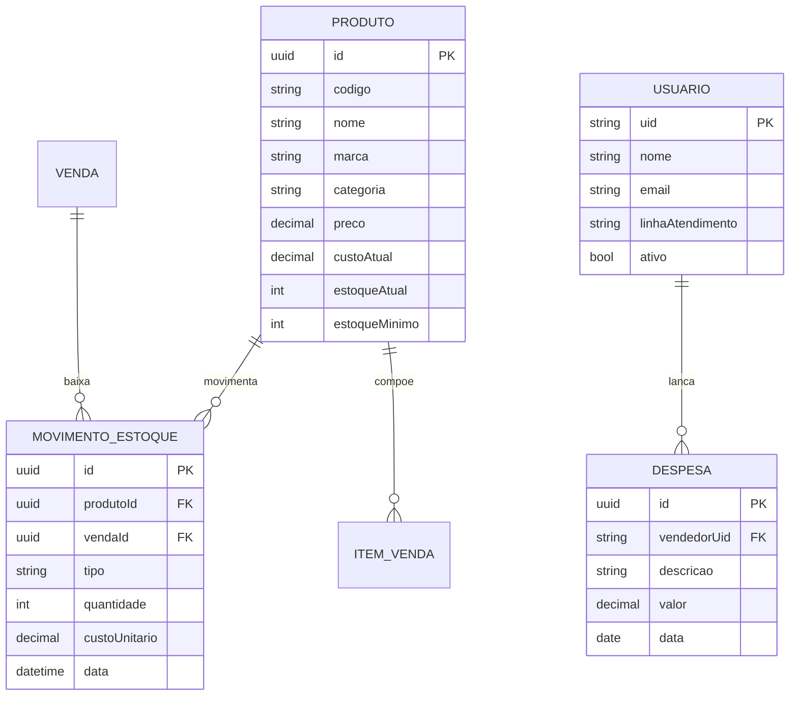

# Modelo lógico de dados

**Projeto:** Sistema de Força de Vendas — Cesta Básica Lopez
**Projeto Integrador III — Faculdade Donaduzzi — Grupo 01**
**Versão:** 1.3 · Sprint 5
**Referência:** Levantamento de Requisitos v01, ADR 001, ADR 002

---

## 1. Diagrama



---

## 2. Diagramas por contexto

Para leitura em tela menor, o modelo pode ser lido em três recortes.

### 2.1 Clientes e roteirização



### 2.2 Vendas e pagamentos



### 2.3 Estoque e financeiro



---

## 3. Dicionário de dados

### USUARIO
Vendedor ou sócio com acesso ao aplicativo. Corresponde ao registro do Firebase Authentication.

| Atributo | Tipo | Descrição |
|---|---|---|
| uid | string | Identificador do Firebase Auth (PK) |
| nome | string | Nome do vendedor |
| email | string | Credencial de acesso |
| linhaAtendimento | enum | `toledo` ou `regional` |
| ativo | bool | Permite desativar sem excluir |

### ROTA
Agrupamento de clientes por região de atendimento (RF06).

| Atributo | Tipo | Descrição |
|---|---|---|
| id | uuid | PK |
| codigo | string | Código da rota |
| nome | string | Nome descritivo |
| linhaAtendimento | enum | `toledo` ou `regional` |

### CLIENTE
Cadastro do cliente atendido em campo (RF01, RF05). Pessoa física identificada por CPF, conforme ADR 002.

| Atributo | Tipo | Descrição |
|---|---|---|
| id | uuid | PK |
| codigo | string | Código interno do cliente |
| nome | string | Nome completo |
| cpf | string | CPF do cliente |
| telefone | string | Contato |
| endereco | string | Endereço de entrega |
| rotaId | uuid | FK para ROTA (RF07) |
| score | enum | `a`, `b`, `c` ou `d` — avaliação de pagamento (RF05) |
| limiteCredito | decimal | Limite para venda a prazo (RF30) |
| bloqueado | bool | Bloqueio administrativo por atraso (RF30) |
| ultimaCompra | date | Data da última venda, para recorrência |
| proximoVencimento | date | Menor vencimento entre parcelas em aberto — base da lista diária (RF09) |
| valorEmAberto | decimal | Soma dos saldos das parcelas não quitadas |

Os dois últimos atributos são desnormalizados e atualizados junto com as parcelas, conforme ADR 002, decisão 6.

### VISITA
Agenda do vendedor: cliente a ser atendido em determinada data (RF08, RF09).

| Atributo | Tipo | Descrição |
|---|---|---|
| id | uuid | PK |
| clienteId | uuid | FK para CLIENTE |
| clienteNome | string | Nome do cliente duplicado, evita busca ao montar a agenda do dia (seção 6) |
| rotaId | uuid | FK para ROTA |
| vendaId | uuid | FK para VENDA, preenchido se resultou em venda |
| dataPrevista | date | Data planejada da visita |
| realizada | bool | Visita concluída |

### PRODUTO
Item comercializado (RF11, RF22).

| Atributo | Tipo | Descrição |
|---|---|---|
| id | uuid | PK |
| codigo | string | Código do produto |
| nome | string | Descrição |
| marca | string | Fabricante |
| categoria | string | Grãos, enlatados, limpeza etc. |
| preco | decimal | Preço de venda |
| custoAtual | decimal | Custo da última compra, base da apuração de lucro (RF27) |
| estoqueAtual | int | Saldo em cache (ver observação 7.1) |
| estoqueMinimo | int | Limite para alerta de estoque baixo (RF24) |

### VENDA
Pedido registrado no atendimento (RF10, RF12, RF18, RF19, RF26). Quando `tipo = parcelado`, constitui a promissória assinada pelo cliente (RF20), conforme ADR 002.

| Atributo | Tipo | Descrição |
|---|---|---|
| id | uuid | PK |
| clienteId | uuid | FK para CLIENTE |
| vendedorUid | string | FK para USUARIO |
| numeroNota | int | Número sequencial da nota provisória (RF18) |
| data | datetime | Data e hora do pedido |
| valorTotal | decimal | Soma dos itens |
| formaPagamento | enum | Opcional. `pix`, `credito`, `debito`, `valeAlimentacao` ou `dinheiro`. Preenchido apenas em venda à vista |
| tipo | enum | `aVista` ou `parcelado` |
| assinaturaBase64 | text | Assinatura digital do cliente (RF19) |
| observacao | text | Registro pós-venda, ex. troca realizada (RF26) |

### ITEM_VENDA
Produto e quantidade dentro de uma venda.

| Atributo | Tipo | Descrição |
|---|---|---|
| id | uuid | PK — necessário para referência em TROCA_ITEM |
| vendaId | uuid | FK para VENDA |
| produtoId | uuid | FK para PRODUTO |
| nome | string | Nome do produto duplicado, evita busca ao exibir os itens da venda (seção 6) |
| quantidade | int | Unidades vendidas |
| precoUnitario | decimal | Preço praticado no momento da venda |
| custoUnitario | decimal | Custo do produto no momento da venda, para apuração de margem (RF27) |

### TROCA_ITEM
Registro de substituição de produto em venda já concluída (RF25), preservando o item original.

| Atributo | Tipo | Descrição |
|---|---|---|
| id | uuid | PK |
| vendaId | uuid | FK para VENDA |
| itemOriginalId | uuid | FK para ITEM_VENDA substituído |
| produtoNovoId | uuid | FK para PRODUTO entregue em substituição |
| produtoNovoNome | string | Nome do produto novo duplicado, evita busca ao exibir a troca (seção 6) |
| quantidade | int | Unidades trocadas |
| diferencaValor | decimal | Diferença de preço, quando houver |
| data | datetime | Momento da troca |

### PARCELA
Plano de pagamento de uma venda parcelada (RF13, RF14, RF15).

| Atributo | Tipo | Descrição |
|---|---|---|
| id | uuid | PK |
| vendaId | uuid | FK para VENDA |
| numero | int | Número da parcela |
| valor | decimal | Valor, alterável (RF15) |
| vencimento | date | Data prevista de recebimento (RF09) |
| pago | bool | Quitada |
| dataPagamento | date | Data efetiva da quitação |
| alteracoes | lista | Histórico das alterações de `valor` (RF15): `valorAnterior`, `valorNovo`, `data` e `motivo` opcional. Estrutura embutida, vazia enquanto o valor original não mudou |

### PAGAMENTO
Registro de recebimento, permitindo pagamento parcial (RF16).

| Atributo | Tipo | Descrição |
|---|---|---|
| id | uuid | PK |
| parcelaId | uuid | FK para PARCELA |
| valor | decimal | Valor recebido |
| data | datetime | Momento do recebimento |
| forma | enum | Meio utilizado |

### MOVIMENTO_ESTOQUE
Entrada, saída ou troca de produto (RF22, RF23, RF25).

| Atributo | Tipo | Descrição |
|---|---|---|
| id | uuid | PK |
| produtoId | uuid | FK para PRODUTO |
| vendaId | uuid | FK para VENDA, quando movimento de saída |
| tipo | enum | `entrada`, `saida` ou `troca` |
| quantidade | int | Unidades movimentadas |
| custoUnitario | decimal | Custo de aquisição, preenchido nos movimentos de entrada |
| data | datetime | Momento do movimento |
| vendedorUid | string | FK para USUARIO, registra quem lançou o movimento (seção 6) |

### DESPESA
Gasto lançado pelo vendedor, ex. combustível (RF27, RF29).

| Atributo | Tipo | Descrição |
|---|---|---|
| id | uuid | PK |
| vendedorUid | string | FK para USUARIO |
| descricao | string | Natureza da despesa |
| valor | decimal | Valor gasto |
| data | date | Data do lançamento |

### Atributos comuns

Todas as entidades que originam coleção ou subcoleção própria possuem, além
dos atributos listados:

| Atributo | Tipo | Descrição |
|---|---|---|
| updatedAt | datetime | Última alteração, usada na resolução de conflitos |
| deleted | bool | Exclusão lógica — exclusão física quebra a sincronização offline |

As estruturas embutidas — ITEM_VENDA, TROCA_ITEM, PAGAMENTO e as alterações de valor da PARCELA — não possuem
esses atributos: não constituem documentos independentes e acompanham o
ciclo de vida e a sincronização do documento que as contém.

---

## 4. Promissória como visão derivada

A promissória é o documento assinado pelo cliente ao adquirir uma venda a prazo. Não constitui entidade armazenada: todos os seus dados derivam de VENDA e PARCELA, conforme ADR 002, decisão 2.

| Informação (RF20) | Origem |
|---|---|
| Existência | `VENDA.tipo = parcelado` |
| Identificação | `VENDA.numeroNota` |
| Assinatura do cliente | `VENDA.assinaturaBase64` |
| Valor original | `VENDA.valorTotal` |
| Saldo devedor | Soma de `PARCELA.saldo` das parcelas não quitadas |
| Status `paga` | Todas as parcelas com `pago = true` |
| Status `atrasada` | Alguma parcela vencida e não quitada |
| Status `aberta` | Demais casos |
| Histórico da dívida | Sequência de PAGAMENTO das parcelas, ordenada por data |

A camada de domínio implementa uma classe `Promissoria` construída a partir de uma venda e de suas parcelas, sem persistência própria.

---

## 5. Apuração de resultado

Conforme ADR 002, decisão 3, o sistema apura lucro real.

```
lucro bruto   = Σ (ITEM_VENDA.quantidade × (precoUnitario − custoUnitario))
lucro líquido = lucro bruto − Σ DESPESA.valor do período
saldo do dia  = lucro líquido do dia
```

O atributo `ITEM_VENDA.custoUnitario` registra o custo vigente no momento da venda. Sem esse instantâneo, a variação de custo entre as compras semanais distorceria a margem das vendas anteriores.

---

## 6. Mapeamento para Firestore

O banco adotado é o Cloud Firestore, orientado a documentos. O modelo lógico acima descreve as entidades e relações; a tabela abaixo registra como cada relação foi implementada.

| Relação no modelo lógico | Implementação no Firestore | Justificativa |
|---|---|---|
| VENDA 1:N ITEM_VENDA | Array `itens` embutido no documento da venda | Itens nunca são consultados isoladamente; evita leitura adicional |
| VENDA 1:N TROCA_ITEM | Array `trocas` embutido no documento da venda | Poucos registros por venda, sempre lidos junto com ela |
| VENDA 1:N PARCELA | Subcoleção `vendas/{id}/parcelas` | Possuem ciclo de vida próprio e são consultadas por vencimento |
| PARCELA 1:N PAGAMENTO | Array `pagamentos` embutido na parcela | Poucos registros por parcela, sempre lidos em conjunto |
| PARCELA 1:N alteração de valor | Array `alteracoes` embutido na parcela | Poucos registros por parcela, sempre lidos em conjunto; gravado com `arrayUnion` para não perder alterações feitas offline |
| CLIENTE 1:N VENDA | Campo `clienteId` mais `clienteNome` duplicado | Desnormalização evita busca do cliente ao listar vendas |
| ROTA 1:N CLIENTE | Campo `rotaId` no documento do cliente | Referência simples por identificador |
| ROTA 1:N VISITA | Campo `rotaId` no documento da visita | Referência simples por identificador |
| PRODUTO 1:N MOVIMENTO_ESTOQUE | Coleção raiz `movimentosEstoque` | Saldo é derivado dos movimentos, não de campo sobrescrito |
| USUARIO | Coleção `usuarios/{uid}` vinculada ao Firebase Auth | O identificador é o UID do Auth, não um UUID gerado |
| ITEM_VENDA → PRODUTO | Campo `produtoId` mais `nome` duplicado | Evita busca do produto ao exibir os itens da venda |
| TROCA_ITEM → PRODUTO | Campo `produtoNovoId` mais `produtoNovoNome` duplicado | Mesma razão |
| VISITA → CLIENTE | Campo `clienteId` mais `clienteNome` duplicado | Evita busca por cliente ao montar a agenda do dia |
| MOVIMENTO_ESTOQUE → USUARIO | Campo `vendedorUid` | Rastreia quem registrou o movimento, necessário à apuração por linha de atendimento |

Estruturas embutidas em documentos — ITEM_VENDA, TROCA_ITEM e PAGAMENTO —
dispensam a chave estrangeira do elemento pai, uma vez que o próprio
documento que as contém já estabelece o vínculo. Os atributos `vendaId` e
`parcelaId` previstos no modelo lógico não são materializados nessas
estruturas.

### Coleções resultantes

```
usuarios/{uid}
rotas/{rotaId}
clientes/{clienteId}
visitas/{visitaId}
produtos/{produtoId}
vendas/{vendaId}
  └── parcelas/{parcelaId}
movimentosEstoque/{movimentoId}
despesas/{despesaId}
configuracoes/geral
```

Oito coleções de dados, uma subcoleção e um documento de configuração. As entidades ITEM_VENDA, TROCA_ITEM e PAGAMENTO não originam coleções próprias: tornam-se estruturas embutidas. PROMISSORIA não é persistida.

O documento `configuracoes/geral` armazena parâmetros operacionais ainda não definidos pela empresa — limite de crédito padrão e número de parcelas em atraso que dispara o bloqueio (RF30) — permitindo ajuste sem nova versão do aplicativo.

### Campos auxiliares de consulta

O Firestore não realiza busca insensível a maiúsculas. Por esse motivo, as coleções `clientes` e `produtos` mantêm o campo `nomeBusca`, contendo o nome em caixa baixa, utilizado pelas consultas de busca por nome (RF02).

### Geração de identificadores

Todo documento recebe um UUID versão 4 gerado no próprio dispositivo, e não o identificador automático do Firestore. Essa decisão permite criar registros sem conexão com a internet, sem risco de colisão entre os dois vendedores em campo (RNF06).

### Operações que exigem escrita em lote

As seguintes operações alteram mais de um documento e devem ser executadas em `batch`, garantindo atomicidade mesmo com a escrita enfileirada offline:

| Operação | Documentos afetados |
|---|---|
| Registrar venda parcelada | `vendas/{id}`, `vendas/{id}/parcelas/*`, `clientes/{id}`, `movimentosEstoque/*` |
| Quitar parcela | `vendas/{id}/parcelas/{id}`, `clientes/{id}` |
| Alterar valor de parcela | `vendas/{id}/parcelas/*`, `vendas/{id}` (se o total mudar), `clientes/{id}` (se o valor em aberto mudar) |
| Registrar troca | `vendas/{id}`, `movimentosEstoque/*` |
| Registrar entrada de estoque | `produtos/{id}`, `movimentosEstoque/*` |

---

## 7. Observações e pendências

### 7.1 Redundância intencional em atributos de cache

O atributo `PRODUTO.estoqueAtual` é redundante em relação a MOVIMENTO_ESTOQUE, o que representa uma desnormalização deliberada. Sua função é servir como cache de leitura para exibição rápida na tela de estoque.

O saldo autoritativo é a soma dos movimentos registrados. A justificativa consta no ADR 001: o Firestore resolve conflitos de escrita pela regra de última escrita prevalecente, de modo que um contador sobrescrito perderia lançamentos caso os dois vendedores registrassem vendas do mesmo produto enquanto offline.

O mesmo raciocínio se aplica a `CLIENTE.proximoVencimento` e `CLIENTE.valorEmAberto`, cuja fonte autoritativa são as parcelas.

### 7.2 Correção do protótipo

As telas apresentadas na Sprint 1 exibem CNPJ e nomes de estabelecimentos comerciais, além de mapa de rota. Conforme ADR 002, o cadastro utiliza CPF e o cliente é pessoa física. As telas devem ser corrigidas antes da Pré-Banca, em 30/09/2026.

### 7.3 Limites não definidos

O atributo `CLIENTE.limiteCredito` e a regra de bloqueio por atraso (RF30) dependem de parâmetros ainda não informados pela empresa: valor do limite de crédito por cliente e número de parcelas em atraso que dispara o bloqueio. Os valores serão armazenados em `configuracoes/geral`. **Pendente de definição antes da Sprint 5.**

### 7.4 Geolocalização

O Levantamento de Requisitos homologado não contempla mapa ou geolocalização; RF06 a RF09 tratam rota como agrupamento lógico e agenda por data. As perguntas correspondentes do roteiro de entrevista não foram respondidas. Recomenda-se descartar o recurso: o Google Maps Platform exige conta de faturamento, mesma restrição que inviabilizou o Firebase Storage, e a funcionalidade depende de conexão, conflitando com o RNF06. **Pendente de confirmação antes da Sprint 6.**

### 7.5 Dados pessoais

As entidades CLIENTE e VENDA armazenam dados pessoais (CPF, endereço, telefone e histórico financeiro), sujeitos à Lei Geral de Proteção de Dados. Recomenda-se definir com os sócios, antes da implantação:

- Uso de dados fictícios durante o desenvolvimento, com dados reais apenas após a homologação;
- Restrição do acesso ao console do Firebase em ambiente de produção;
- Destinação dos dados ao término do projeto acadêmico.

---

## 8. Controle de revisões

| Data | Versão | Histórico |
|---|---|---|
| 10/09/2026 | 1.0 | Versão inicial do modelo lógico, elaborada na Sprint 2 a partir do Levantamento de Requisitos v01 e do ADR 001. |
| 16/09/2026 | 1.1 | Aplicação do ADR 002: identificação por CPF confirmada; PROMISSORIA convertida em visão derivada; inclusão de `custoAtual`, `custoUnitario` e apuração de lucro real; entidade TROCA_ITEM criada; atributo `id` acrescentado a ITEM_VENDA; `fiado` removido das formas de pagamento e `formaPagamento` tornada opcional; `proximoVencimento` e `valorEmAberto` acrescentados a CLIENTE; `numeroNota` acrescentado a VENDA; documento `configuracoes/geral` previsto. |
| 16/09/2026 | 1.2 | Ajustes de documentação decorrentes da implementação: escopo dos atributos comuns restrito às entidades com coleção própria; registro das desnormalizações de `ITEM_VENDA.nome`, `TROCA_ITEM.produtoNovoNome`, `VISITA.clienteNome` e `MOVIMENTO_ESTOQUE.vendedorUid`; nota sobre ausência de chave estrangeira em estruturas embutidas. |
| 09/11/2026 | 1.3 | Alteração do valor de parcela (KAN-32): atributo `alteracoes` acrescentado a PARCELA como estrutura embutida; operação "Alterar valor de parcela" incluída entre as escritas em lote. |
