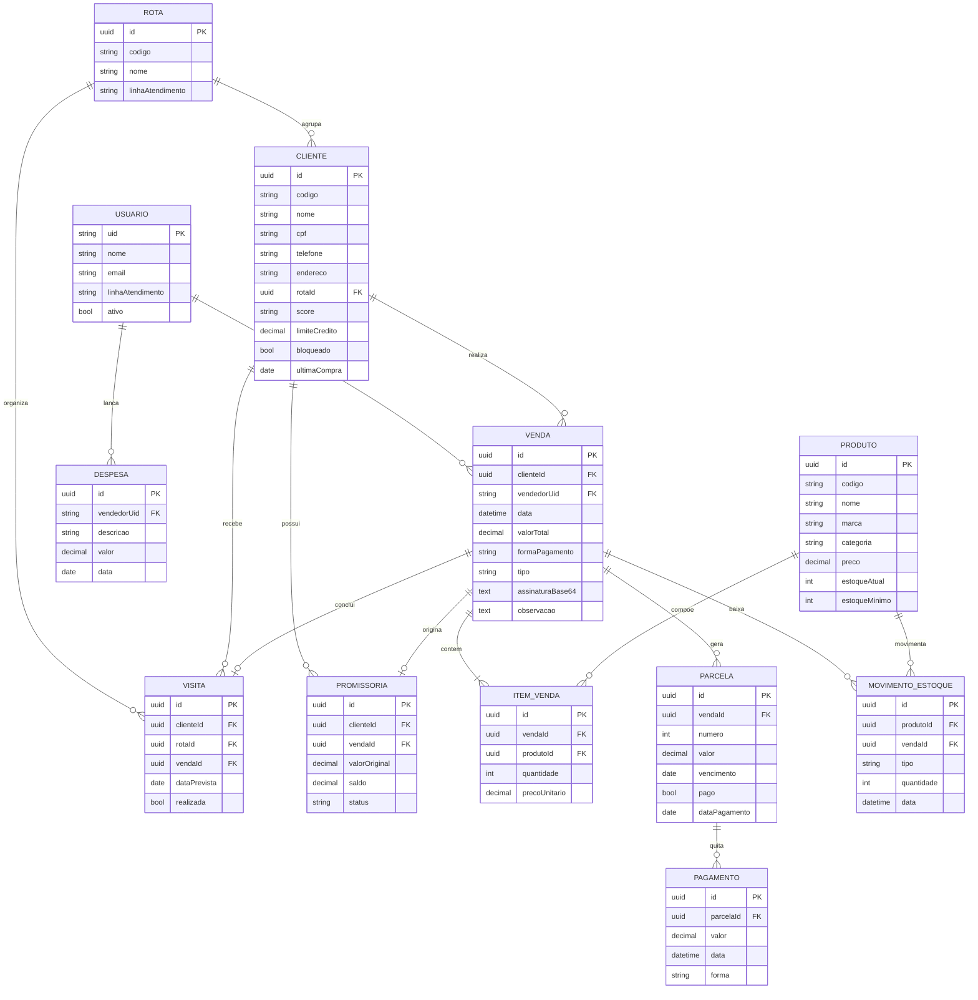
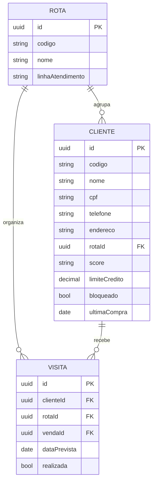
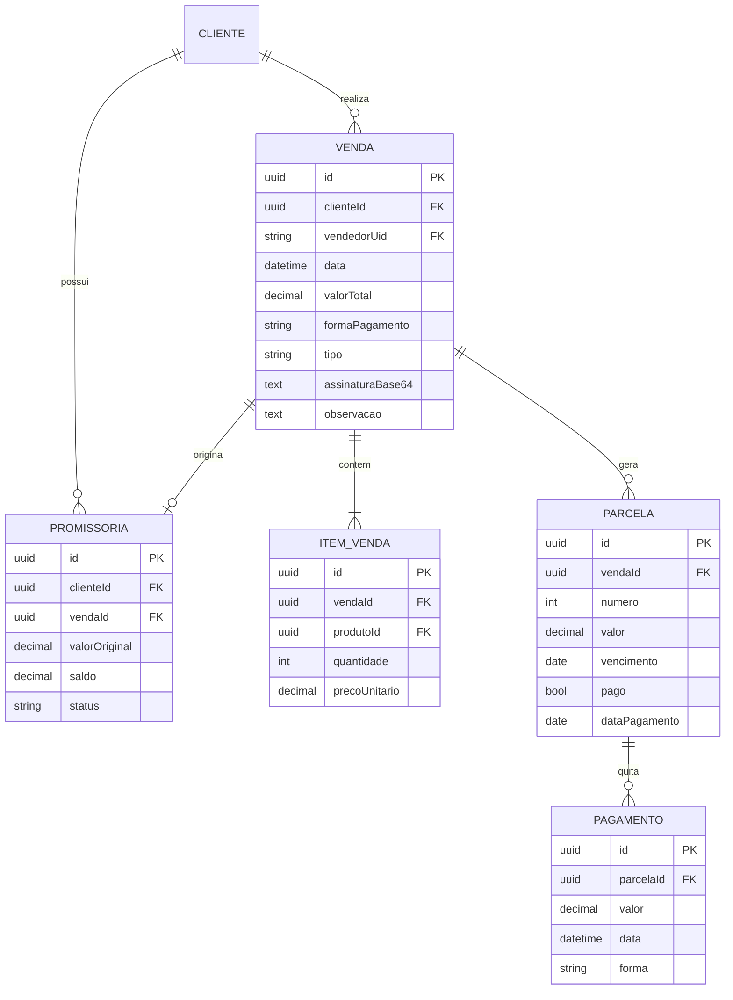
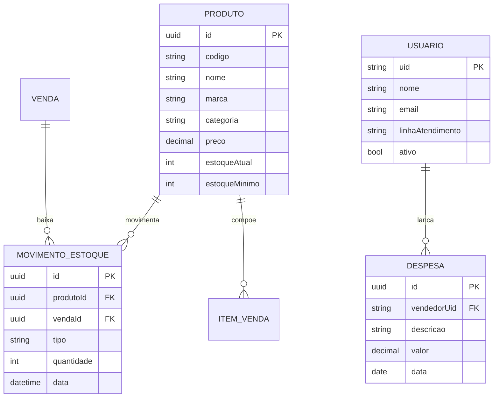

## 1. Diagrama



---
Para leitura em tela menor, o modelo pode ser lido em três recortes.

### 2.1 Clientes e roteirização



### 2.2 Vendas e pagamentos



### 2.3 Estoque e financeiro



---

## 2. Dicionário de dados

### USUARIO
Vendedor ou sócio com acesso ao aplicativo. Corresponde ao registro do Firebase Authentication.

| Atributo | Tipo | Descrição |
|---|---|---|
| uid | string | Identificador do Firebase Auth (PK) |
| nome | string | Nome do vendedor |
| email | string | Credencial de acesso |
| linhaAtendimento | enum | `toledo` ou `regional` |
| ativo | bool | Permite desativar sem excluir |

### ROTA
Agrupamento de clientes por região de atendimento (RF06).

| Atributo | Tipo | Descrição |
|---|---|---|
| id | uuid | PK |
| codigo | string | Código da rota |
| nome | string | Nome descritivo |
| linhaAtendimento | enum | `toledo` ou `regional` |

### CLIENTE
Cadastro do cliente atendido em campo (RF01, RF05).

| Atributo | Tipo | Descrição |
|---|---|---|
| id | uuid | PK |
| codigo | string | Código interno do cliente |
| nome | string | Nome completo |
| cpf | string | CPF (ver pendência 5.2) |
| telefone | string | Contato |
| endereco | string | Endereço de entrega |
| rotaId | uuid | FK para ROTA (RF07) |
| score | enum | `a`, `b`, `c` ou `d` — avaliação de pagamento (RF05) |
| limiteCredito | decimal | Limite para venda a prazo (RF30) |
| bloqueado | bool | Bloqueio administrativo por atraso (RF30) |
| ultimaCompra | date | Data da última venda, para recorrência |

### VISITA
Agenda do vendedor: cliente a ser atendido em determinada data (RF08, RF09).

| Atributo | Tipo | Descrição |
|---|---|---|
| id | uuid | PK |
| clienteId | uuid | FK para CLIENTE |
| rotaId | uuid | FK para ROTA |
| vendaId | uuid | FK para VENDA, preenchido se resultou em venda |
| dataPrevista | date | Data planejada da visita |
| realizada | bool | Visita concluída |

### PRODUTO
Item comercializado (RF11, RF22).

| Atributo | Tipo | Descrição |
|---|---|---|
| id | uuid | PK |
| codigo | string | Código do produto |
| nome | string | Descrição |
| marca | string | Fabricante |
| categoria | string | Grãos, enlatados, limpeza etc. |
| preco | decimal | Preço de venda |
| estoqueAtual | int | Saldo em cache (ver observação 5.1) |
| estoqueMinimo | int | Limite para alerta de estoque baixo (RF24) |

### VENDA
Pedido registrado no atendimento (RF10, RF12, RF18, RF19, RF26).

| Atributo | Tipo | Descrição |
|---|---|---|
| id | uuid | PK |
| clienteId | uuid | FK para CLIENTE |
| vendedorUid | string | FK para USUARIO |
| data | datetime | Data e hora do pedido |
| valorTotal | decimal | Soma dos itens |
| formaPagamento | enum | `pix`, `credito`, `debito`, `valeAlimentacao`, `dinheiro`, `fiado` |
| tipo | enum | `aVista` ou `parcelado` |
| assinaturaBase64 | text | Assinatura digital do cliente (RF19) |
| observacao | text | Registro pós-venda, ex. troca realizada (RF26) |

### ITEM_VENDA
Produto e quantidade dentro de uma venda.

| Atributo | Tipo | Descrição |
|---|---|---|
| id | uuid | PK |
| vendaId | uuid | FK para VENDA |
| produtoId | uuid | FK para PRODUTO |
| quantidade | int | Unidades vendidas |
| precoUnitario | decimal | Preço praticado no momento da venda |

### PARCELA
Plano de pagamento de uma venda parcelada (RF13, RF14, RF15).

| Atributo | Tipo | Descrição |
|---|---|---|
| id | uuid | PK |
| vendaId | uuid | FK para VENDA |
| numero | int | Número da parcela |
| valor | decimal | Valor, alterável (RF15) |
| vencimento | date | Data prevista de recebimento (RF09) |
| pago | bool | Quitada |
| dataPagamento | date | Data efetiva da quitação |

### PAGAMENTO
Registro de recebimento, permitindo pagamento parcial (RF16).

| Atributo | Tipo | Descrição |
|---|---|---|
| id | uuid | PK |
| parcelaId | uuid | FK para PARCELA |
| valor | decimal | Valor recebido |
| data | datetime | Momento do recebimento |
| forma | enum | Meio utilizado |

### PROMISSORIA
Dívida consolidada do cliente, com status e histórico (RF20).

| Atributo | Tipo | Descrição |
|---|---|---|
| id | uuid | PK |
| clienteId | uuid | FK para CLIENTE |
| vendaId | uuid | FK para VENDA de origem |
| valorOriginal | decimal | Valor inicial da dívida |
| saldo | decimal | Valor em aberto |
| status | enum | `aberta`, `paga` ou `atrasada` |

### MOVIMENTO_ESTOQUE
Entrada, saída ou troca de produto (RF22, RF23, RF25).

| Atributo | Tipo | Descrição |
|---|---|---|
| id | uuid | PK |
| produtoId | uuid | FK para PRODUTO |
| vendaId | uuid | FK para VENDA, quando movimento de saída |
| tipo | enum | `entrada`, `saida` ou `troca` |
| quantidade | int | Unidades movimentadas |
| data | datetime | Momento do movimento |

### DESPESA
Gasto lançado pelo vendedor, ex. combustível (RF27, RF29).

| Atributo | Tipo | Descrição |
|---|---|---|
| id | uuid | PK |
| vendedorUid | string | FK para USUARIO |
| descricao | string | Natureza da despesa |
| valor | decimal | Valor gasto |
| data | date | Data do lançamento |

### Atributos comuns

Todas as entidades possuem, além dos atributos listados:

| Atributo | Tipo | Descrição |
|---|---|---|
| updatedAt | datetime | Última alteração, usada na resolução de conflitos |
| deleted | bool | Exclusão lógica — exclusão física quebra a sincronização offline |

---

## 3. Mapeamento para Firestore

O banco adotado é o Cloud Firestore, orientado a documentos. O modelo lógico acima descreve as entidades e relações; a tabela abaixo registra como cada relação foi implementada.

| Relação no modelo lógico | Implementação no Firestore | Justificativa |
|---|---|---|
| VENDA 1:N ITEM_VENDA | Array `itens` embutido no documento da venda | Itens nunca são consultados isoladamente; evita leitura adicional |
| VENDA 1:N PARCELA | Subcoleção `vendas/{id}/parcelas` | Possuem ciclo de vida próprio e são consultadas por vencimento |
| PARCELA 1:N PAGAMENTO | Array `pagamentos` embutido na parcela | Poucos registros por parcela, sempre lidos em conjunto |
| CLIENTE 1:N VENDA | Campo `clienteId` mais `clienteNome` duplicado | Desnormalização evita busca do cliente ao listar vendas |
| ROTA 1:N CLIENTE | Campo `rotaId` no documento do cliente | Referência simples por identificador |
| ROTA 1:N VISITA | Campo `rotaId` no documento da visita | Referência simples por identificador |
| PRODUTO 1:N MOVIMENTO_ESTOQUE | Coleção raiz `movimentosEstoque` | Saldo é derivado dos movimentos, não de campo sobrescrito |
| USUARIO | Coleção `usuarios/{uid}` vinculada ao Firebase Auth | O identificador é o UID do Auth, não um UUID gerado |

### Coleções resultantes

```
usuarios/{uid}
rotas/{rotaId}
clientes/{clienteId}
visitas/{visitaId}
produtos/{produtoId}
vendas/{vendaId}
  └── parcelas/{parcelaId}
promissorias/{promissoriaId}
movimentosEstoque/{movimentoId}
despesas/{despesaId}
```

Nove coleções raiz e uma subcoleção. As entidades ITEM_VENDA e PAGAMENTO não originam coleções próprias: tornam-se estruturas embutidas nos documentos de VENDA e PARCELA, respectivamente.

### Campos auxiliares de consulta

O Firestore não realiza busca insensível a maiúsculas. Por esse motivo, as coleções `clientes` e `produtos` mantêm o campo `nomeBusca`, contendo o nome em caixa baixa, utilizado pelas consultas de busca por nome (RF02).

### Geração de identificadores

Todo documento recebe um UUID versão 4 gerado no próprio dispositivo, e não o identificador automático do Firestore. Essa decisão permite criar registros sem conexão com a internet, sem risco de colisão entre os dois vendedores em campo (RNF06).

---

## 4. Observações e pendências

### 4.1 Redundância intencional em PRODUTO.estoqueAtual

O atributo `estoqueAtual` é redundante em relação a MOVIMENTO_ESTOQUE, o que representa uma desnormalização deliberada. Sua função é servir como cache de leitura para exibição rápida na tela de estoque.

O saldo autoritativo é a soma dos movimentos registrados. A justificativa consta no ADR 001: o Firestore resolve conflitos de escrita pela regra de última escrita prevalecente, de modo que um contador sobrescrito perderia lançamentos caso os dois vendedores registrassem vendas do mesmo produto enquanto offline.

### 4.2 CPF ou CNPJ

O documento de Levantamento de Requisitos especifica CPF no cadastro de clientes (RF01). O protótipo apresentado na Sprint 1 exibe CNPJ e nomes de estabelecimentos comerciais. Trata-se de modelos de negócio distintos, com impacto em validação, máscara de entrada e tela de cadastro.

O modelo lógico assume CPF, conforme o documento homologado. **Pendente de confirmação com os sócios Neiva e Manuel.**

### 4.3 Distinção entre PARCELA e PROMISSORIA

Ambas as entidades representam valores a receber. A separação adotada neste modelo é a seguinte:

- **PARCELA** é o plano de pagamento de uma venda parcelada, com número, valor e vencimento definidos no momento da venda (RF13, RF14).
- **PROMISSORIA** é o registro consolidado da dívida do cliente, com status e histórico de evolução do saldo (RF20).

**Pendente de confirmação com os sócios** se a separação corresponde ao processo real da empresa, ou se ambos os termos designam o mesmo instrumento.

### 4.4 Limites não definidos

O atributo `CLIENTE.limiteCredito` e a regra de bloqueio por atraso (RF30) dependem de parâmetros ainda não informados pela empresa: valor do limite de crédito por cliente e número de parcelas em atraso que dispara o bloqueio. **Pendente de definição antes da Sprint 5.**

### 4.5 Dados pessoais

As entidades CLIENTE e VENDA armazenam dados pessoais (CPF, endereço, telefone e histórico financeiro), sujeitos à Lei Geral de Proteção de Dados. Recomenda-se definir com os sócios, antes da implantação:

- Uso de dados fictícios durante o desenvolvimento, com dados reais apenas após a homologação;
- Restrição do acesso ao console do Firebase em ambiente de produção;
- Destinação dos dados ao término do projeto acadêmico.

